# BioZero project flow: implemented profile and remaining gates

Updated 2026-10-14. This guide describes the measured local synthetic profile.
The [requirements matrix](team/requirements-and-gates.md) preserves the wider
Notion roadmap and distinguishes implementation from proposed capabilities.

```mermaid
flowchart LR
  Browser[Reviewer browser] -->|HTTPS session, Origin and CSRF| Gateway[Reviewer gateway]
  Gateway -->|Own mTLS identity, prepared signed/encrypted input| Upload[Upload API]
  CLI[Uploader CLI A or B] -->|Individual mTLS, signed/encrypted input| Upload
  Upload --> Jobs[Durable job and encrypted upload files]
  Jobs --> Worker[Single worker: verify digest/signature, decrypt]
  Worker -->|Only accepted input| Pipeline[FASTQ validation and explicit stats/variants pipeline]
  Pipeline --> Evaluator[Independent synthetic truth evaluator]
  Evaluator --> Reports[Terminal execution and separate scientific release]
  Reports --> Results[Results API: certificate ownership]
  Results -->|Own result through mTLS| Gateway
  Results --> CLI
  Gateway -->|Allowlisted report| Browser
  FutureSOC[SOC integration: pending] -.-> Responder[Optional response simulation]
```

## Input and identity

CLI clients use individual certificates. The reviewer gateway provisions separate
mTLS transports for each reviewer, with high-entropy invitation codes and opaque
session cookies. Sign-in requires the configured Origin, JSON and rate limiting;
authenticated state-changing requests also require a CSRF token.
The default catalog accepts only prepared synthetic experiments; arbitrary
uploads and command selection are outside that browser interface.

Protected mode requires complete TLS/mTLS configuration. Backend certificate CN
and serial identify a job owner; a caller-supplied client header does not change
ownership. CLI and gateway encrypt inputs for the worker and sign them with
fixture-held demo signing material. The worker verifies cryptography before
analysis: Upload API queue acceptance alone does not approve an input. Original
upload digests are preserved; derived digests are separate.

## Processing and scientific release

The filesystem job store supports one worker. It validates integrity, signature
and encryption, decrypts into a per-job temporary workspace, and removes plaintext
after processing. The container profile additionally bounds its plaintext tmpfs;
native temporary files do not establish a kernel memory/storage cap.
Cancellation/deadlines stop its process groups; interrupted
work becomes an explicit failure on restart. Container/process isolation does
not demonstrate hardware-enclave attestation.

The pipeline validates FASTQ structure and runs an explicit mode. `stats` supplies
transport/statistics evidence. `variants` requires the configured reference,
minimap2, SAMtools and BCFtools plus their successful stages and artifacts.
Optional QC does not substitute for missing mandatory variant stages.

Execution states are `uploaded`, `running`, `succeeded`, `incomplete`, `rejected`,
`failed` and `timed_out`. Scientific release is independently `evaluated_passed`,
`withheld` or `unassessed`. A successful process alone cannot approve science.
Historical `processed` records remain incomplete until validated.

BZ-EXP-001 fixes a 6 kb reference, 1,171 reads and three expected SNPs. The
evaluator counts all normalized alleles and compares two executions with that
answer key. TP=3, FP=0, FN=0 and equal callsets establish only this synthetic
allele-presence result. Genotype, indel, WGS, biological and clinical accuracy
are separate questions.

## Results, browser and evidence

Results API and gateway enforce ownership. Typed public reports contain statuses,
stage codes, scientific counts and provenance; they exclude private paths, raw
diagnostics, signing records and arbitrary artifact URLs. The UI escapes text
and guards explicit A/logout/B transitions against old asynchronous callbacks.
Profiles share cookies across tabs; automatic identity synchronization of every
tab is not implemented. Simultaneous accounts require separate profiles.

Native acceptance passed ten assertions and was reproduced from another checkout.
Compose/Firefox passed 31 integration assertions and 23 browser checks, with zero
JavaScript errors. Hosted ARM CI separately passed unit/PKI/scientific/native
checks. See [STATUS](STATUS.md), [experiment001](experiments/001-variant-smoke.md)
and [reproduction commands](runbooks/reproduce.md) for exact dated receipts.

Share only reviewed `public/` bundles. Derived VCFs retain normalized allele
presence but omit sample names, paths, commands, genotypes and unevaluated fields.
Original VCFs, keys, invitations, cookies, profiles and diagnostics remain private.
Earlier raw exports contain local paths and must not be published. Checksums
identify the exact exported bytes.

## Runtime and roadmap

Observed: RHEL 9.8 ARM64, one CPU, about 5.45 GiB RAM. Measured containers run
non-root with read-only roots, dropped capabilities, limits and scoped keys.
Entry binds loopback; worker has no network. Normal API/gateway bridges do not
enforce egress denial. Oracle capacity/deployment remains unverified.

SCI01 loaded verified Sei-LLRA checkpoints and measured one synthetic pair.
Comparable FP32 was faster than QNNPACK; the current recomputation path has a
provisional economic no-go. SCI02 is building a real-window FP32 adapter with
fixed GM12878 ATAC-seq head aggregation. Ten-locus preflight and hundred-locus
biological evaluation require permitted data, explicit effect alleles, frozen
selection/splits and evidence. Operator tests and mutation controls do not
complete them. Disjoint windows alone do not remove linkage disequilibrium.

ZeroResponder currently records simulation. SIEM ingestion, enforced response,
evolving adversary scenarios, production identity, HSM/KMS, encrypted results,
queue/claim/lease, hardware attestation and external deployment each require
explicit designs and demonstrated acceptance. Component names do not establish
those features.
