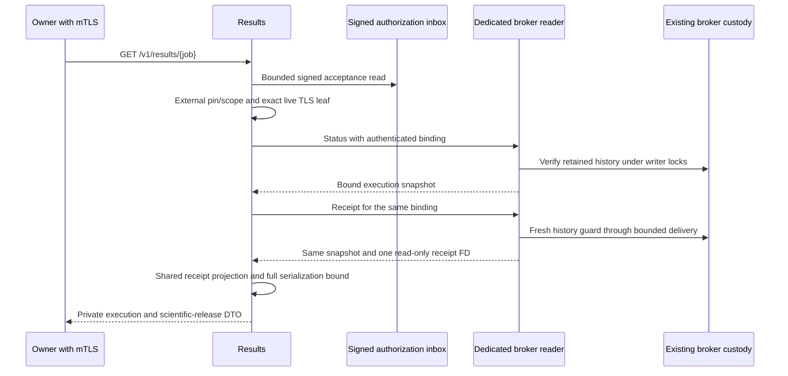

# Owner Results and the dedicated broker reader

This contract covers the explicitly selected `owner-v1` Results API and the
dedicated reader for a V3 owner broker. It extends the
[owner execution contract](ownership-execution-contract.md). A scientific result
is projected from retained broker custody; a worker cache is observability only.
Implementation and executed acceptance are separate claims. See
[status](../STATUS.md) for the current evidence and remaining gates.

## Authorization and projection



Results accepts only a lowercase 16-hex job identifier, a bodyless GET and no
query parameters. TLS 1.3 and an individually verified client certificate are
mandatory. The principal comes from the actual server TLS connection; application
headers, common names and certificate serial numbers do not grant ownership.
Current certificate validity is checked on requests, including kept-alive TLS
connections. Historical signed acceptance is not re-expired as a new challenge.

The signed acceptance inbox is the only per-job file read before authorization.
Results verifies its signature against the externally configured authority key,
authority ID, producer profile, mode and genesis scope. Its signed job must match
the URL, and its credential SHA must match the exact authenticated leaf. Failure
returns a generic denial before any broker or receipt query. No authority private
signing key, worker decryption key, owner key or legacy job/result root is part of
the Results configuration.

Authorized requests use only the dedicated reader socket. Status and receipt
must agree on the entire V3 binding, including acceptance/credential/scope,
original ciphertext, processed plaintext/context, producer profile, Store/lease,
manifest and receipt hashes and sizes. A noncommitted binding stays
pending/withheld; absence or uncertainty never submits or cancels work. A genuine
failed/withheld commit without an execution receipt is supported explicitly.

Worker and Results use the same `receiptprojection.ParsePolicy` and
`ProjectCapsuleReceipt` implementation. Operator-pinned source hashes and byte
limits are configuration, never learned from a receipt. The projector validates
the retained receipt, source and context bindings, scientific evaluation,
detection and release rules before constructing private metrics. Results does
not run pipeline, evaluation or detection tools.

## Closed protocols and custody

The reader uses schema 1 and distinct request/response domains
`biozero.artifact.owner-reader.request.v1` and
`biozero.artifact.owner-reader.response.v1`. Its only operations are `status` and
`receipt`. Request fields are schema/domain/operation, job ID, acceptance SHA,
credential SHA, original upload SHA, expected profile SHA and authority scope.
No request can supply a file descriptor, command, path, reservation or quota.
There is no Submit, Cancel or ACK operation on this socket.

The codec rejects unknown, missing, case-aliased, duplicate or null required
fields, invalid UTF-8, excessive depth, oversized frames and trailing data.
Every frame byte is read with ancillary-aware socket IO. Receipt rights occur
only with the first response byte; extra/late/request rights are rejected and
closed. Both peers verify `SO_PEERCRED`. The client verifies receipt regular-file
type, broker UID, private mode, one link, read-only and close-on-exec flags,
length/hash and stable metadata. Broker UID is not inferred from Results UID.

The reader shares the existing writer's custody. It never opens a second Store,
changes the ledger, completes a journal seal, acknowledges storage, refunds a
charge or reconciles unknown history. The fresh delivery guard holds broker then
Store locks through the actual bounded transport write. A prior healthy snapshot
cannot bypass a storage fault observed by another handler.

Cancellation, disconnected readers, partial writes, timeouts and ordinary
descriptor duplication failures affect the read only. Trusted journal, ledger,
proof, manifest or receipt corruption and observed trusted-storage IO failures
fence writer custody. Trusted storage validation does not inherit a client's
cancellation; a concurrent cancel cannot hide an already observed storage fault.
The final server-side descriptor check uses an explicitly typed storage failure
under the still-held delivery guard. This is separate from a failed execution
ACK on the worker socket, whose semantics are unchanged.

## Configuration and resource bounds

Select Results with `BIOZERO_RESULTS_PROTOCOL=owner-v1` and the absolute private
`BIOZERO_OWNER_RESULTS_CONFIG` path. Selection occurs before legacy environment
handling, directory creation or HTTP registration. Unknown/mixed selections and
owner configuration failures terminate; they cannot fall through to legacy.
The earlier legacy endpoint remains separately selected and is not an owner-v1
authorization route.

The schema-1 Results configuration requires protocol, literal loopback address,
signed-acceptance directory and its expected UID, reader socket and broker UID,
external authority ID/public key, pipeline mode, producer profile, external
genesis scope, and hash-pinned TLS certificate/key/client CA/projection-policy
assets. Fields are closed and explicitly required, including numeric UID zero
where applicable to validation. Native service policy requires configured UIDs
to equal the process UID. Assets/config are bounded 64KiB, mode0600, one-link
regular files, read once through no-follow anchored directories with stable
metadata. Inbox directories are private0700; assets and reader/inbox roots cannot
overlap. Startup creates no directories. Parsed TLS and policy material is kept
from those measured snapshots rather than reread between hash check and parse.

| Resource | Bound |
| --- | --- |
| Reader connections / active handlers | 4 / 2 |
| Reader metadata frame | 64KiB |
| Reader request / operation / write | 5s / 30s / 5s |
| Results connections / active result requests | 4 / 2 |
| Results HTTP headers | 16KiB configured maximum |
| Results header read / idle | 5s / 15s |
| Results processing / final response write | 30s / 5s |
| Results complete serialized response | 16MiB |

The HTTP server allows 40s for its overall write deadline, then installs the
shorter final-write deadline after projection. Its transport is HTTP/1.1 over
TLS1.3. `/healthz` is bounded authenticated liveness and does not inspect the
authorization inbox or broker. No per-job cache or unbounded rate-limit map is
introduced. Byte limits do not establish an RSS cap or a hard kernel filesystem
IO deadline. A response exceeding the full serialized limit is withheld rather
than truncated or replaced with raw receipt JSON.

The private response domain is `biozero.results.owner.v1`, schema1. It carries job
and acceptance, execution state, execution/release status and error code, original
and processed hashes, mode, projected pipeline/evaluation/detection and opaque
artifact bindings. It excludes certificate DER, original filenames, ciphertext
or key envelopes, raw stdout/stderr, raw VCF and capsule namespace paths. Private
authorized metrics are not automatically approved public exports.

Both broker listeners drain before provider/Store release. Results stops HTTP
admission, cancels read contexts and drains HTTP handlers before closing the
signed inbox. It joins the launched Serve goroutine before returning, including
cancellation before Serve starts. First terminal and cleanup errors are
retained. A read write failure never becomes a Store ACK failure.

## Profiles, reproduction and remaining gates

Use `cmd/artifact-owner-read-broker` with closed wrapper configuration containing
`schema_version`, the existing `owner` configuration and `reader` socket/UID.
`--print-profile` seals the reader policy and the broker executable without
creating state. Authority genesis then supplies the external scope; including
that scope in the producer hash would create a cycle, so it is excluded.

Adding the reader changes the broker executable hash and producer profile.
Create fresh authority genesis, Store, journal and worker custody. Never open an
old producer's history as though it belonged to the new executable, re-sign old
acceptances or reset old charges. Retain previous profiles and evidence.

The opt-in native acceptance is:

```sh
python3 biozero/infra/native/run_owner_worker.py \
  --results \
  --run-dir /absolute/new/private/evidence-directory \
  --tools-prefix /absolute/existing/tool-prefix
```

It uses existing ARM64 tools, its own producer binary and fresh profile/genesis,
real HTTPS/mTLS,
the protected worker and native capsule provider. It retains all sources,
binaries, attempts, keys, workspaces, logs and charges privately. Its default
without `--results` remains the separately scoped worker acceptance. No previous
worker receipt is relabeled as Results acceptance.

An explicit `--reuse-build-report` can copy the exact nine Results executables
from retained evidence only after identical initial/final Go/module inputs and
all executable hashes, byte counts, private ownership/modes, single-link and
stable metadata checks. The earlier eight-binary worker set is incompatible.
Failure never falls back to compilation. This saves redundant builds after a
harness-only correction; it still creates entirely new runtime state and
preserves the original build receipt and failed attempt.

This first native policy uses same-UID private0700 directories and0600 sockets.
It trusts host files and that UID; it does not demonstrate deployed role/key/mount
isolation. Different UIDs require a separately configured and observed traversal,
socket group/ACL and mount policy. Gateway/UI adaptation, integrated active-job
reader failures, complete V3 lifecycle/reconciliation, deployed isolation and
the remaining TM02 gates stay open until their own acceptance proves them.
