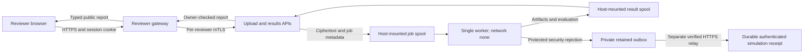
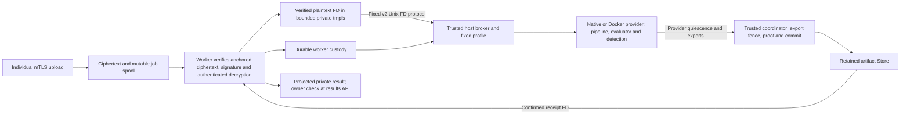

# BioZero local threat model

Initial review:2026-10-14. Current capsule boundary review:2026-10-15, below.
Inspection base: `afbb354b8406ce6095be402f9e31194896b2c284`, plus the current
working tree at the initial review. The post-review section below records the
subsequently executed security-event delivery; older receipts retain their own scope.

This model covers the demonstrated local synthetic reviewer profile, the native
experiment and the bounded regulatory research tools. It distinguishes inspected
code from executed acceptance evidence. The [current status](../STATUS.md),
[state decision](../decisions/001-job-states.md) and
[network decision](../decisions/002-local-container-network.md) govern scope.
Changing the deployment, identities, data, mounts or event path requires a new
review and acceptance run.

The [current capsule boundary review](#protected-capsule-route-current-boundary-review)
records the protected worker/broker/Store route and supersedes older execution-
location descriptions without replacing their historical evidence.

## Trust boundaries

All container nodes and both spools depend on the same privileged host and Docker
daemon. The diagram's separate nodes do not imply independent hardware trust.
The worker is a software process/container, not a demonstrated hardware TEE.
Its network isolation is observed for the accepted Compose profile; APIs and
gateway use a normal project bridge that does **not** enforce egress denial.

The browser proves possession of a private invitation code and session cookie;
that is demo reviewer identity, not verified employment, cloud IAM or patient
identity. The gateway owns both reviewers' distinct mTLS keys and a fixture
signing key. Compromise of the gateway crosses both reviewer boundaries. The
CLI/API path is a separate enabled interface and must preserve its own ownership
and admission controls; browser quotas alone do not protect that path.

The spools are a trust boundary with shared write permissions, not a trusted
database. Upload and worker containers can write global job metadata. Results
authorization depends on that metadata. Atomic writes prevent partial files;
they do not authenticate the writer, ownership fields or scientific result.
Processes sharing the configured host UID and a privileged host can change files
despite container read-only roots or per-file `0600` permissions.

## Assets and attackers

| Asset | Security objective | Relevant attacker or failure |
| --- | --- | --- |
| Invitations, cookies, CSRF tokens and reviewer identity | Prevent impersonation and cross-reviewer report release | Anonymous local caller, a malicious reviewer, leaked invitation, stolen browser/session or compromised gateway |
| CA, API TLS, per-reviewer mTLS, signing and worker decryption keys | Separate roles and prevent unauthorized decrypt/sign/authentication | Host/Docker administrator, compromised service, accidental public bundle or backup |
| Uploads, owner metadata, run registry and states | Preserve original digest, ownership and truthful lifecycle | Valid client bypassing gateway, compromised spool writer, interrupted or concurrent workers, disk corruption |
| Plaintext, BAM/VCF artifacts, truth, references and reports | Limit disclosure and preserve scientific provenance | Compromised worker/tool, filesystem writer, misleading report or accidental publication |
| CPU, RAM, disk, descriptors, process slots and caches | Keep bounded progress and avoid resource exhaustion | Oversized/malformed input, repeated valid uploads, slow clients, hanging tools, growing spool/cache |
| Research source, dependencies, checkpoints and dataset receipts | Preserve trusted source/byte/version/terms boundaries | Malicious or changed upstream, poisoned local cache, compromised dependency, unsupported dataset semantics |
| Proposed events and action records | Preserve causal provenance and distinguish simulation from enforcement | Forged/replayed event, duplicate consumer, partial persistence, exaggerated containment claim |

The demonstrated workload contains synthetic/public authorized inputs. Real
genomic data, multi-tenant production and clinical decisions remain outside this
acceptance. This model does not claim protection against a malicious privileged
host, effective SOC containment, hardware attestation or verified Oracle identity.

## Controls and supporting evidence

The local receipt below is
[Compose manifest, 31 assertions](../evidence/20261014T150658-139518Z-reviewer-compose/public/manifest.json).
The accompanying [Firefox receipt, 23 checks](../evidence/20261014T150658-139518Z-reviewer-compose/public/browser-checks.json)
records the tested browser behavior. These ignored evidence directories must be
preserved/exported as reviewed public bundles; a fresh checkout does not include
them. Test names identify code contracts; their presence alone is not a PASS.

| Boundary/control | Evidence and current status | Practical limit |
| --- | --- | --- |
| HTTPS browser trust; protected API mTLS | Local receipt: `gateway_https_health`, both `*_mtls_certificate_required`; Firefox: untrusted demo CA rejected and configured CA verified | Private demo CA; loopback publication, not external certificate lifecycle or production deployment |
| Certificate CN and serial determine API ownership; headers cannot replace verified identity | Local receipt: `api_certificate_b_cannot_read_a_1/2`; [results tests](../../services/results-api/main_test.go), `TestAuthorizationRequiresCertificateAndOwner`; [upload tests](../../services/upload-api/main_test.go) reject unverified/header identity | Trusts the local CA and mutable job ownership metadata; no production revocation service established |
| Individual gateway sessions, immutable per-principal backend transports, ownership registry | Local receipt: distinct sessions, both reviewer B denials, isolated history and restart/relogin recovery; [gateway tests](../../services/reviewer-gateway/main_test.go), `TestConcurrentABTLSIdentityAndActualEncryptedSubmission` | Gateway holds both keys; invitation possession is the identity proof; direct APIs remain distinct interfaces |
| Exact Origin, CSRF token, secure/HttpOnly/SameSite cookies, expiration and logout | Local receipt: foreign Origin and missing CSRF denied, cookie replay after logout denied; session/expiration tests in gateway | Does not protect a fully compromised browser or same-origin application; headers and TTLs are also inspected code controls |
| Delayed A callbacks cannot populate/interfere with the explicit B transition | Firefox receipt includes stale history/view/session/start callbacks and zero JS errors | Tested local Firefox page transitions; automatic identity synchronization across all tabs is not implemented |
| Prepared experiments, empty run-request schema and gateway admission | Local receipt rejects unknown experiment; gateway code permits one active run per reviewer, two globally, 20 total per reviewer and five run requests/minute | Quotas are gateway-local; no proof of whole-system byte/disk/queue admission through the direct API |
| Original upload hash, RSA-PSS signature and AES-GCM decryption before analysis | Local receipt: immutable original hashes; [native receipt](../evidence/20261014T150910-330979Z/public/manifest.json) rejects unsigned input; [worker tests](../../services/enclave-runner/main_test.go), `TestProtectedRejectsBeforePipeline` | Demo signer shared by fixture clients; signature covers ciphertext, not an authenticated owner/metadata database |
| Truthful terminal states and separate scientific release | Local receipt: valid runs evaluated, malformed FASTQ failed/withheld and repeated TP=3/FP=0/FN=0; worker scientific release tests and gateway typed-report tests | Three synthetic SNP allele-presence cases only; success/exit zero is not biological or clinical acceptance |
| Bounded subprocess lifetime and worker shutdown | Worker tests: `TestPipelineDeadlineKillsDescendant`, `TestWorkerSignalsCancelPipelineDescendants`, `TestScientificReleaseCancellationKillsDescendants`; reported passing suites in STATUS | Linux process-group implementation; metadata/file reads and all host resource paths need separate bounds |
| Container non-root UID, read-only root, dropped capabilities, no-new-privileges, PID/RAM/CPU limits; worker network none | Local receipt: all four `container_controls_*` assertions, selected HostConfig and exact mounts recorded | Host/Docker root bypasses these controls; same host UID and writable bind mounts remain trusted; gateway/API egress not denied |
| Role-scoped PKI mounts and tmpfs for Compose decrypted payloads | PKI tests and container-control receipt; API receives its server keys, worker its decrypt key, gateway reviewer keys and fixture signer | CA/decrypt/client private material still exists on host; native profile uses private host storage; plaintext scientific artifacts may persist privately |
| Atomic JSON replacement and registry unhealthy latch | Worker atomic-write tests; gateway `TestRegistryFailureBlocksAllRunRelease` and `TestInFlightReportCannotReleaseAfterPersistenceLatch`; race tests reported in STATUS | Crash consistency is not tamper evidence, a durable queue, multi-worker leasing or an append-only audit log |
| Typed gateway reports and explicit public artifact allowlists | Gateway `TestTypedDTOAndScientificReleaseFailClosed`; public bundle checksums; [independent checkout receipt](../evidence/20261014T150823-057533Z-independent-checkout/public/independent-checkout.json); public VCF export tests | Only approved exports may be shared; old raw VCFs, logs, DNA, prediction vectors, config and private directories remain private |
| Pinned dependency/source/checkpoint bytes and bounded acquisition | [Checkpoint manifest](../../research/regulatory/checkpoints.json), [acquisition receipt](../../research/regulatory/checkpoint-acquisition.json), fetch tests and offline probes; size/SHA checks, budget and deadlines; `weights_only=True` and strict state dict | SHA pins prove agreement with the selected manifest, not upstream honesty, legal permission or safety of every loaded component |
| Biological data boundary, source receipts and offline normalized-case validation | [Adapter](../../research/regulatory/biological_adapter.py) and tests reject invalid/nonregular/symlink input and inconsistent pins; [control receipt](../../research/regulatory/adapter-control-runtime.json) has zero biological truth cases | Dataset permission/effect semantics and ten/100 real loci pending; an instrumentation control cannot satisfy biological accuracy |

## Residual risks and concrete findings

These findings are static inspection/inference. No damaging exploit, disk-fill
test or unauthorized disclosure was performed. The conditions distinguish an
ordinary reviewer from an actor who already has filesystem or service access.

| ID | Finding and precondition | Consequence | Next acceptance gate |
| --- | --- | --- | --- |
| TM-01 | A valid client can submit directly to upload API. It limits each request to 25 MiB and defaults to 60 requests/minute per IP, but has no demonstrated global/per-owner pending-byte or disk quota/retention. Gateway quotas do not cover this route. | Persistent upload/job/artifact growth can exhaust the host; rejected scientific inputs still cost admission/storage. Rate controls and container RAM limits do not bound disk. | Admission must account for active/pending jobs and bytes across enabled interfaces; reject before persistence when limits/free-space reserve are exceeded; demonstrate bounded cleanup and failure recovery with small fixtures. |
| TM-02 | A compromised upload service or host-side writer can change global `jobs/`. [Results authorization](../../services/results-api/main.go) trusts `client_id` and certificate serial from that JSON. An attacker also possessing a valid client identity could rewrite another job's owner fields. | Direct API ownership can be reassigned without changing its signed ciphertext. Gateway's separate registry helps its own route, but does not authenticate direct API job metadata. | Separate immutable authorization records from mutable worker state, bind them to a trusted owner/creation record and limit writers; negative tamper tests must prove both gateway and API deny reassignment. |
| TM-03 | With filesystem write access, a FIFO/symlink/large `.json` can be placed in the job spool. Worker skips directories but otherwise calls `os.ReadFile`; results reads metadata/results similarly without a regular-file and byte-size contract. | A FIFO can block the single worker before its subprocess timeout; symlinks or oversized files can redirect reads or exhaust resources. This was not demonstrated via normal upload HTTP. | Open bounded regular files without following links, validate job/result schemas and fail explicitly; test FIFO, symlink, oversize and shutdown behavior without attacking a live run. |
| TM-04 | Host/Docker administrators, a compromised worker or a local process sharing the configured UID can access mounted private material and mutable artifacts. All services use that host UID for the local demo. | Keys, raw data, metadata and reports can be read/replaced; signatures/checksums stored alongside compromised data cannot establish an independent trustworthy origin. | Before multi-tenant deployment, choose separate identities/storage privileges, key lifecycle, immutable provenance and a declared host trust assumption; evaluate attestation only if actually supported. |
| TM-05 | The gateway retains both reviewers' mTLS keys and the demo signing key; invitation/session theft or gateway compromise crosses the reviewer boundary. Demo CA/key generation is local and expiration-limited, without a demonstrated rotation/revocation workflow. | Reviewer impersonation and signed synthetic submissions; possible exposure of both reviewers through one compromised service. | Production authentication/authorization and key storage/rotation/revocation must be designed and tested; retain synthetic-only scope until then. |
| TM-06 | Source/dependency/checkpoint caches and manifests depend on a trusted operator. Hashes, repository commit and `weights_only` reduce selected risks but do not establish license or trustworthy upstream provenance by themselves. | Poisoned trusted pins/dependencies or unapproved redistribution/data use can undermine reproducibility and release. Cache, model RSS and accumulated outputs consume host resources separately from transfer budgets. | Verify source/terms independently, bound cache/storage and inference, preserve complete receipts and reject altered/unsupported artifacts. Derived Drive checkpoint distribution terms remain unestablished; no checkpoint redistribution. |
| TM-07 | Existing optional ZeroResponder accepts alerts without a shared secret when `BIOZERO_WEBHOOK_SECRET` is empty, and uses local HTTP. Its action outputs are records/list files. The new event/outbox/responder path has no acceptance receipt in this model. | An accessible legacy simulation endpoint can receive unauthorized or replayed alerts and misleading action records; logs are not enforced blocking, certificate revocation or containment. | Keep optional simulation out of external publication; require authenticated bounded event admission, validation/idempotency and explicit `simulated` outcomes. Verify the new path before changing this finding. |
| TM-08 | Queue/lease/multi-worker behavior is not established; file scanning explicitly supports one worker and interrupted runs require resubmission. Browser rate/session state and global resource policy are local. | Enabling concurrent consumers or publishing beyond loopback can introduce duplicate work, races, cross-instance quota gaps and denial of service outside existing evidence. | Verified atomic claim/lease/idempotency and measured resource/identity policy are prerequisites to multiple workers or external deployment. |

## Initial event and response acceptance requirements

At the initial review, worker outbox, telemetry consumption and the new responder
were **proposed/pending verification**; the executed post-review evidence below
supersedes that implementation state. They are drawn with dashed arrows deliberately:
the accepted four-service run does not include this response path. Existing
optional responder records do not prove the new event contract, an SIEM/SOC,
effective blocking or enforcement.

The next response receipt must establish event provenance from the job/result,
fixed version/schema and bounded fields; no raw sequences, keys, paths or model
vectors in released events. It must test invalid/forged/replayed events, duplicate
delivery, atomic persistence, consumer restart, partial failure, quotas and
cleanup. Simulated action records must identify what was requested and recorded
without representing a file/list update as an enforced network, certificate or
host policy. The worker must retain its accepted `network_mode: none` boundary;
adding any network or shared-key access requires a new design and review.

An event failure must not silently turn failed/withheld science into approved
science or erase its originating evidence. How mandatory telemetry failure
affects execution/release is an explicit contract decision, not inferred here.

## Release and review conditions

Only reviewed public allowlist artifacts may leave private storage. Original
tool VCF headers can contain private paths/sample names; public synthetic VCFs
derive the normalized allele set and explicitly omit genotype, quality, filters
and annotations. Preservation of this set is demonstrated; preservation of
those omitted scientific fields is not claimed. Keep failure states and partial
evidence visible in the run manifest rather than publishing a bare success
metric as whole-system approval.

External exposure requires decisions and evidence for real identity, revocation,
network policy, storage/admission, tenant isolation, secrets and authorized data.
Oracle credentials/resources, hardware TEE, clinical safety, production readiness,
all-tab session synchronization and effective SOC response remain unverified or
outside scope. The free-only constraint continues to apply.

Update this model after an independently reviewed change to any boundary above.
Record source snapshot, executed receipt, affected risk IDs and remaining limits;
new code or a green historical test does not close a threat by itself.

## Post-review security-event evidence

The worker outbox, responder and separate relay were integrated. Independent
review of the canonical/identity/storage contracts verified three fixes
(numeric-zero versus false, receipt-parent fsync and precise TLS negative tests).
Native receipt `../evidence/20261014T165148-344656Z/public/` passed22 assertions,
including12 security-event cases. The chain binds a persisted protected rejected
result to its minimal retained event, verified HTTPS acknowledgment and durable
private simulation receipts. It verifies restart/outbox recovery and idempotent
redelivery, conflict/authentication/strict-input rejection and no effective lists.

Four-service Compose receipt
`../evidence/20261014T164550-385353Z-reviewer-compose/public/` passed30 checks
with exact outbox mount and worker network none. The earlier mount-allowlist
verifier failure is preserved in STATUS. The optional responder container receipt
`../evidence/20261014T165334-020175Z-soc-container/public/` passed13 assertions
and cleanup, including parent/result binding, HTTPS/authentication/restart replay,
private receipt permissions, scoped TLS keys, container controls and loopback entry.
Seventeen source hashes remained unchanged; no pipeline/model ran in that second
experiment. The shared source secret is held by the separate relay, not the worker.

TM-07's historical optional-auth/best-effort implementation is replaced: current
ZeroResponder requires a secret and TLS away from loopback, validates bounded
exact JSON, publishes a complete no-clobber fsynced receipt, rejects changed payload
IDs and latches unavailable after ambiguous persistence failure. Source remains a
claim of a secret holder, not attestation. The source/result filesystem remains
trusted. Response is always simulation with enforced=false. Effective blocking,
revocation, containment, SIEM integration, per-source identity, quotas/retention
and continuously supervised relay remain pending. TM-01/02/03/04/05/06/08 are not
closed by these receipts. See [decision003](../decisions/003-security-event-handoff.md)
and the [event contract](event-contract.md) for adopted semantics.

## Post-review metadata and lifecycle evidence

TM-03's original unsafe-read finding is narrowed by the [metadata contract](metadata-contract.md).
Job/result readers now anchor no-follow descriptors, check regular type/private
mode/effective UID, bound bytes and JSON depth, and reject ambiguous typed records.
Worker recovery/SOC reconciliation use the same parser; API authorization precedes
result IO. The 54 shared vectors and process/unit fixtures cover the declared scope.
Native `../evidence/20261014T175423-175221Z/public/` passed53 checks, including
nine live FIFO/link/oversize/duplicate fixtures, ongoing new worker progress and
exact cleanup. A projected65,536-byte admitted job remained readable after actual
terminal rejection;65,537 was refused without orphan files. The initial raw-byte
cap could not cover lifecycle growth and was replaced by a worst-field projection
and one bounded worker writer. Full result diagnostics and immutable upload
fields are retained; older unreserved jobs fail closed before oversized writes.

Rebuilt Compose `../evidence/20261014T175423-180461Z-reviewer-compose/public/`
passed30 controls and scoped cleanup. Separate root-only fixtures isolate foreign
UID rejection; their services were not run as root. No browser/model or optional
responder container was rerun. Other payload/PKI/config reads, arbitrary kernel IO
latency, trusted host/UID and mutable owner provenance remain residual risks.
TM-01 admission/storage budgets and TM-02 immutable authenticated owner records
are next adopted gates; this change does not close TM-04/05/06/08 or effective SOC.

## TM-01 retained-input and command-output work

The [admission contract](admission-contract.md) defines a further TM-01 subgate:
all enabled upload interfaces use persistent global/per-verified-CN job and byte
accounting, with reservations before body reads and charges retained after worker
completion or a lost HTTP acknowledgement. CN renewal shares its bucket; quota
identity cannot come from a form/header/IP. One uploader owns the locked ledger.
Missing/corrupt state over retained data fails closed without an empty baseline.
Policy is pinned, and migration, legacy adoption and operator reclamation remain
pending. These controls do not authenticate mutable authorization metadata.

Worker captures now limit pipeline/evaluator stdout to1MiB and stderr to64KiB.
Overflow cancels the process group and withholds partial scientific output;
oversized serialized results become an explicit small failed/withheld envelope
that preserves original hashes and established crypto flags. Optional alignment
warnings alone do not fail an otherwise independent scientific evaluation.
Wrapper-internal memory, full SAM output, target maps and generated artifacts
remain separately unbounded. This does not close all CPU/RAM/disk paths.

The first local candidate passed78 native checks, but its separate Compose run
failed publication between bind mounts after ten controls. Both receipts retain
their original source hashes. Equal filesystem device IDs did not establish
cross-mount hardlink support. The revised layout stages each input/job within
its destination mount, preserving narrow mounts and no-clobber publication;
its acceptance must be recorded separately after fresh execution. See STATUS
for the final candidate's evidence rather than treating the earlier78 as proof
of the subsequent correction.

Fresh corrected native `../evidence/20261014T192150-539678Z/public/` passed78
checks, and rebuilt Compose `../evidence/20261014T192150-561120Z-reviewer-compose/public/`
passed30 plus cleanup. They preserve ownership/crypto/scientific boundaries
while exercising the corrected layout. The separately reported real three-mount
handler/restart regression is `../evidence/20261014T192234-593374Z-admission-mount/public/`.
It used no real TLS or inference. Native small-quota checks and the gateway
integration are separate runs; concurrent CLI/gateway exhaustion of one retained
principal's final slot remains additional acceptance rather than an inferred test.

TM-01 remains open for generated SAM/BAM/BCF/VCF/reference copies, result/event/
receipt/registry totals, caches, filesystem quotas and retention. The free-space
sensor cannot prevent unrelated writers filling disk. TM-02 immutable owner
records, queue/leases, shared host/UID trust and effective SOC remain open.

The small caQTL [acquisition receipt](../../research/regulatory/small-source-acquisition.json)
and [structure receipt](../../research/regulatory/small-source-structure.json)
advance TM-06 source-byte/terms visibility. Complete published size/MD5 and local
SHA pins were verified within a separate50MiB ledger, without changing the model
transfer ledger. Descriptive decoding does not establish genomic REF/liftover,
effect mapping, context or training independence. Raw rows remain private and
zero biological loci had been inferred at that acquisition checkpoint; subsequent
evaluation and its unchanged scientific limitations are recorded below.

## Protected capsule route: current boundary review

Updated2026-10-15 UTC, published implementation4e9e119. This section supersedes
older descriptions of execution location and missing retained-artifact limits;
the earlier observations retain their own source and experimental scope.

The host broker, Store, configured sources and any Docker daemon remain trusted.
Neither a profile digest nor a Unix peer UID authenticates an individual tenant
or attests the host. Worker custody binds immutable job facts to one execution;
it does not make the authorization owner immutable. TM-02 therefore remains open.
Compromised shared-UID/privileged writers remain outside this boundary.

Protected worker acceptance passed25native checks and30three-service Compose
checks, both with the native capsule provider. Independent retained-state
readback passed78/35. See [the pinned evidence](../evidence/20261015-protected-capsule-worker/public/README.md).
The new route verifies actual crypto facts, preserves ciphertext/plaintext hashes,
requires committed receipt projection and recovers lost publication without
resubmission. Unknown running work, unsafe metadata and uncertain transport or
durable state fence new admission. A clean-stop recovery does not establish
worker/broker crash, cancellation, lost ACK or safe operator reconciliation.

The native launcher checks a32MiB/4096inode-unit plaintext tmpfs, zero capabilities
and isolated network namespace, but retains access to the trusted host filesystem tree;
host files and any filesystem credentials remain within that trusted boundary.
It is not a host-file sandbox. In Compose the worker instead receives explicit
role mounts, no Store/Docker socket and network none. The Docker capsule provider
has separate component acceptance for a128MiB/4096inode-unit workspace,64MiB files,
caps-zero/no_new_privs, read-only mounts/root and observed cgroup limits. Subsequent
[protected Docker-provider acceptance](../evidence/20261015-protected-docker-capsule-worker/public/README.md)
passed57assertions and52independent readback checks with actual crypto, science,
authorization and clean-stop/result recovery. Three capsule configurations were
observed while created; helper kernel records were obtained during execution.
The observer's die/destroy events are separate from provider/coordinator wait,
export fencing and proof authority. Subsequent
[postcommit fault acceptance](../evidence/20261015-protected-postcommit-faults/public/README.md)
adds downstream response loss26/41 and whole worker-container SIGKILL/restart32/45
actual/independent checks. Each has one Submit/capsule and query-only recovery of
unchanged artifacts/proofs/custody/charges. Simultaneous namespace/tmpfs references
prove a new empty plaintext filesystem on container restart; temporarily retaining
the old mount tree is measurement authority, not secure erasure. Subsequent
[broker/cancellation evidence](../evidence/20261015-broker-cancel-recovery/public/README.md)
adds committed-only broker socket recovery (31 actual/48 independent checks) and
operator active cancellation of a waiting lifecycle fixture (17/49). A verified
dead own child, pinned socket/pidfd, unchanged complete committed history, rejected
identical restart and directory fsync precede replacement. This is explicit fixture
operation, not a production stale-socket or pending-state recovery service. Socket
unlink is not conditional by inode; cooperative host/same-UID writers remain trusted.
The proxy holds the worker response through the outage, so unavailable-broker query
retries and actual upstream ACK-write failure are not demonstrated. Cancel retains
three physical original before-state files and rechecks them before the frame;
this is not an adversarial atomic transaction across files. Failure withholds
science, fences exports and retains the slot/actual metadata charge. No client
cancellation API follows. Active broker/capsule death, process-only death retaining
plaintext, storage/removal faults and uncertain-state reconciliation remain open.
No hardware-enclave, independent principal identity or complete filesystem quota
follows from either provider's resource controls.

TM-01 is narrower but not closed: retained artifacts have a1GiB/64slot Store and
64MiB export bound; worker/broker journals each have separate1MiB limits plus one
replacement. Reservations and uncertain history are retained without implicit
refund, retry, adoption or deletion. These are logical bounds, not complete
principal/result/event/cache/physical-spool/retention quotas. TM-03 gains bounded,
anchored receipt projection and a shared114-case metadata corpus. Trust in the
fixed broker/provider remains essential: the worker codec does not independently
recheck every mount option or compare the Docker receipt's native-helper digest
to a separately supplied helper pin. Provider/helper checks and the executable-
derived profile cover that configured execution; do not attribute those checks
to the codec or claim independent attestation.

TM-04/05/06/08 remain open for host/identity/key separation, production key
lifecycle, dependency/image build/distribution/license closure and concurrent
queue/lease behavior. The current image is an exact cached local ID, without a
verified reproducible build. No persistent cloud deployment or effective SOC
containment is established. API loopback publishing does not deny bridge egress.

Later regulatory work completed100frozen evaluation cases with finite identical
repeats, sign agreement61/100 and Spearman0.1840864086408641. This is descriptive
GBR/LCL-to-GM12878 transfer, without proven head-training holdout, LD independence,
matched-scale biological accuracy or clinical validity. The comparable FP32/
QNNPACK economic no-go is unchanged. See [biological evidence](../experiments/005-biological-evaluation.md).

## Owner delivery adapter boundary

The explicit owner-v1 CLI/upload transport verifies externally pinned signed
acceptance, exact leaf DER and actual ciphertext/envelope before publishing the
original signed job ID. The private spool keeps full charges and refuses pending
recovery unchanged. Its unsigned ledger and TLS ACK are fabricable by a
compromised upload/host; consumers must independently verify signed context and
remeasure bytes. The retained27-control native response-loss acceptance and
separate unit TCP-RST/SIGKILL controls do not establish deployed key separation,
worker/broker AAD/acceptance-hash enforcement, Results authorization or scientific
release. TM02 remains open. See the
[delivery contract](ownership-delivery-contract.md).

## Owner worker and V3 broker boundary

The explicit owner worker verifies signed external pin/scope/job/profile and
actual envelope/ciphertext before mandatory AAD decryption, Stage and custody.
V3 passes canonical acceptance separately from plaintext and binds its owner facts
before artifact Reserve. Broker trusts the worker's verified plaintext/context;
it has no decryption key or original envelope. Query-only recovery ignores mutable
terminal jobs/cache. Shared receipt projection validates retained science/source
facts before that process releases its stage. Owner cache is observability only;
the legacy SOC outbox does not automatically apply to the owner loop.

[Native53 and independent96 controls](../evidence/20261015-owner-worker-execution/public/README.md)
cover valid/repeat/invalid synthetic execution and real B acceptance over copied A
ciphertext rejected without staging or new execution state. The generic worker
log does not expose its specific GCM error; the causal AAD inspector and exact
input/source controls support that inference. Full authority/upload promises and
all prior failed/weaker work remain retained. Logical sidecar/journal/artifact
bounds are not a complete physical filesystem quota.

TM02 remains open for owner authorization before private Results bytes, a separate
status/receipt-only reader socket, Gateway/UI and integrated owner/result relabel
negatives, plus deployed UID/mount/network/key separation. Actual owner-V3
response-loss, upstream ACK failure, execution-time broker death, process-only
plaintext recovery and uncertain-storage operator reconciliation need their own
acceptance. Same-host UID/root/provider/CA/authority/worker/broker trust, image build
closure, physical/per-principal quotas, retention and attestation remain explicit.
See the [execution contract](ownership-execution-contract.md).
